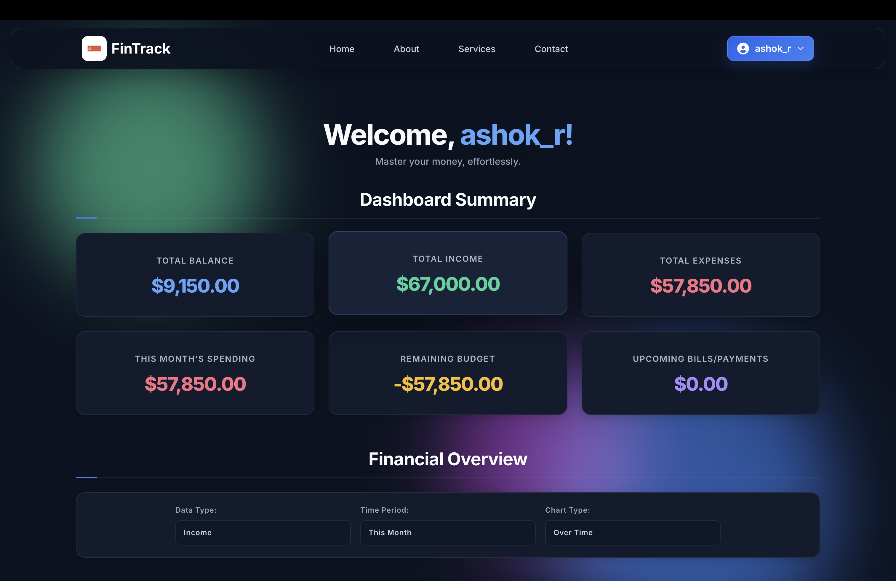
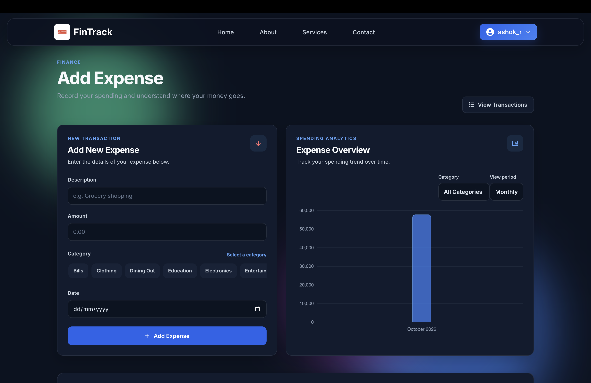
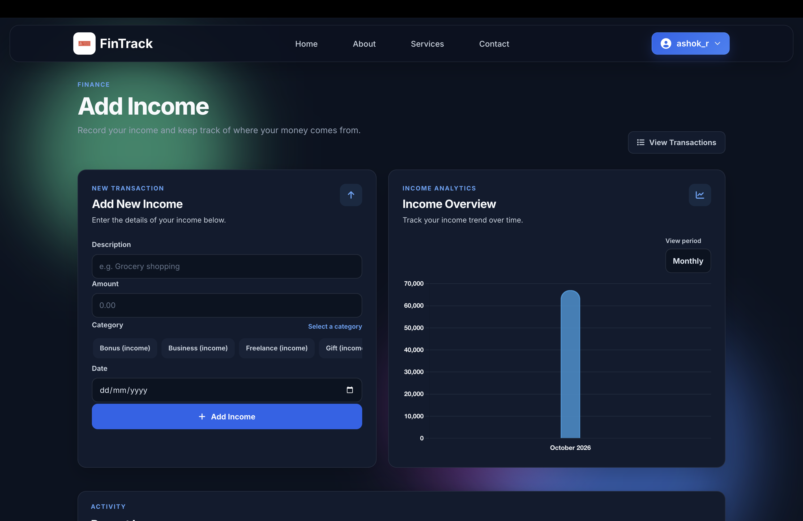
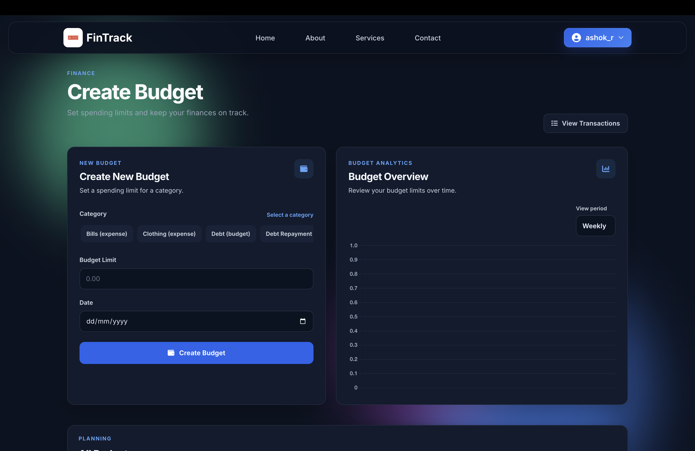
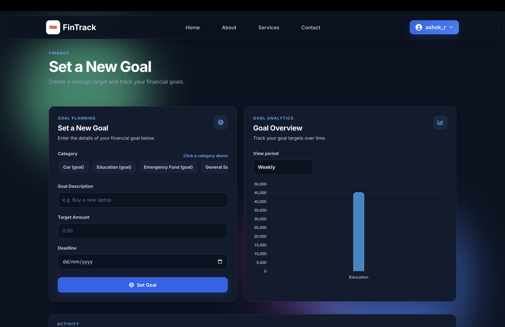
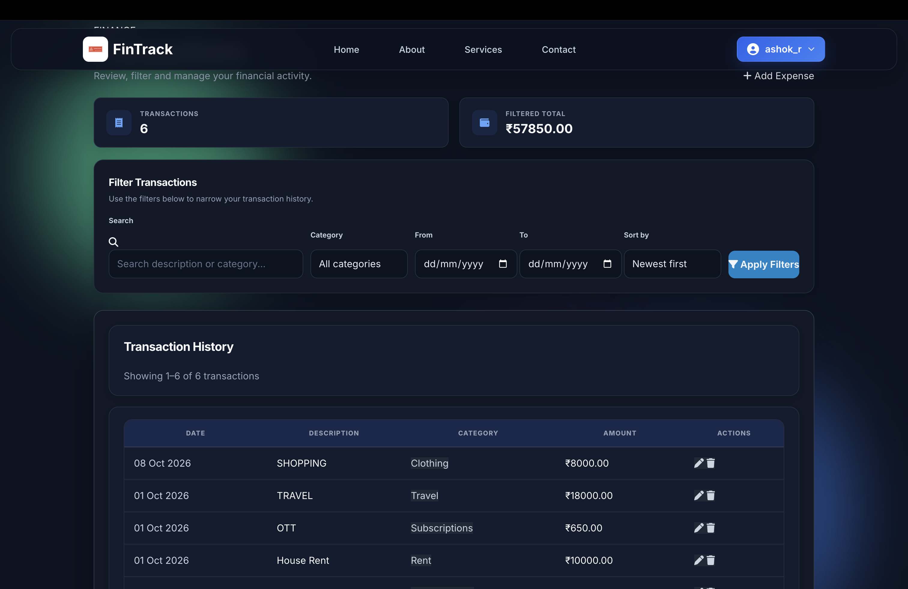
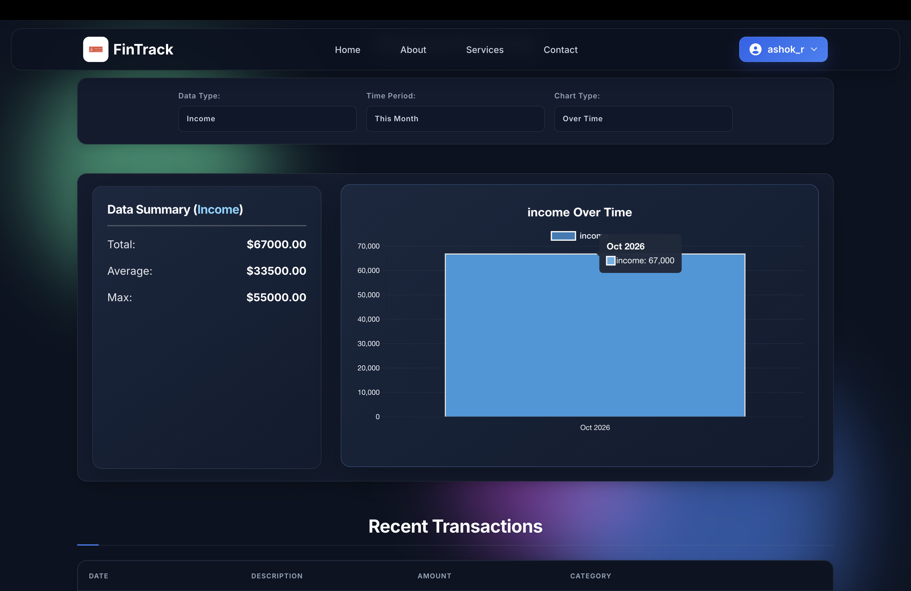
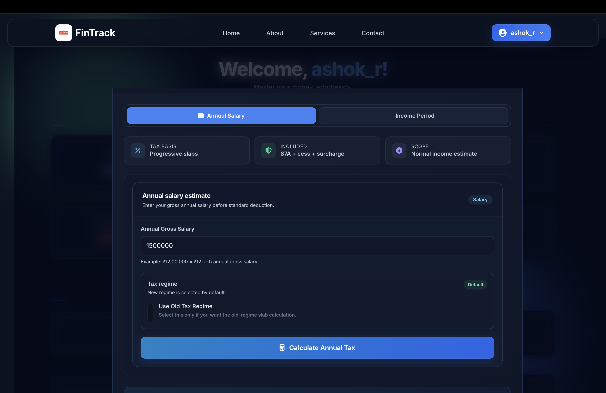
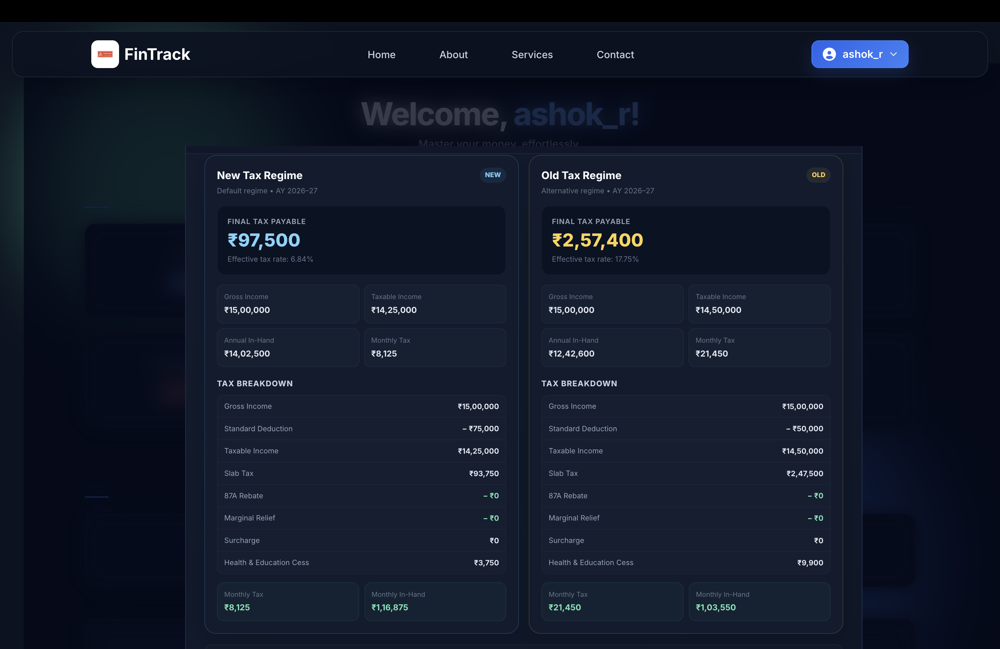

<div align="center">

# FinTrack

### Personal Finance & Expense Tracker

**Track smarter. Budget better. Build financial clarity.**

A Django-powered personal finance application for managing expenses, income, budgets, savings goals, and financial insights.

[](https://www.python.org/)
[](https://www.djangoproject.com/)
[](https://developer.mozilla.org/)
[](https://www.mysql.com/)

[**▶ Watch Demo**](https://youtu.be/OmTtc8KnCes) ·
[**View Source Code**](https://github.com/Ashokreddy45/EXPENSE-TRACKER)

</div>

---

## Overview

**FinTrack** is a personal finance management web application built with Python and Django. It brings everyday financial activities into one place, helping users record transactions, monitor budgets, track savings goals, and understand their spending patterns.

The project demonstrates full-stack web development, database management, financial calculations, form validation, automated testing, and deployment configuration.

## Application Preview

### Dashboard



### Expense Management



### Income Management



### Budgets and Savings Goals

| Budget Management | Savings Goals |
|---|---|
|  |  |

### Transactions and Analytics

| All Transactions | Visualisations |
|---|---|
|  |  |

### Tax Estimation

| Tax Estimation | Tax Calculation Details |
|---|---|
|  |  |

[**Watch the complete 2-minute demo on YouTube →**](https://youtu.be/OmTtc8KnCes)

## Features

- **Financial dashboard** — review key financial metrics and summaries.
- **Expense management** — add, edit, categorize, and delete expense records.
- **Income tracking** — maintain income entries.
- **Budget management** — create budgets and review spending against budget allocations.
- **Savings goals** — set targets, record current savings, and monitor progress and remaining amounts.
- **Savings planning** — view suggested daily, weekly, and monthly savings requirements.
- **Goal deadline reminders** — management command for eligible 7-day and 1-day deadline reminders, with duplicate-send protection.
- **Transaction history** — review financial activity.
- **Financial analytics** — explore totals and spending patterns.
- **Tax estimation** — estimate tax using the calculation rules implemented in the application.
- **User accounts and profiles** — manage individual user information.
- **Responsive interface** — access the application through a styled web interface.
- **Automated tests** — test application behavior and important business logic.

> Tax estimates are informational and should be verified against applicable official tax rules. Email reminders require working email configuration and execution of the management command; automatic scheduling must be configured separately.

## Technology Stack

| Area | Technology |
|---|---|
| Language | Python |
| Backend | Django |
| Frontend | HTML, CSS, JavaScript |
| UI styling | Tailwind CSS and custom stylesheets |
| Database | MySQL locally; SQLite can be selected through configuration |
| Static files | WhiteNoise |
| Production server | Gunicorn |
| Automated testing | Django test framework |
| Version control | Git and GitHub |
| Deployment target | Render |

## Project Structure

```text
EXPENSE-TRACKER/
├── expense_tracker_ashok/
│   ├── settings.py
│   ├── urls.py
│   └── wsgi.py
├── home/
│   ├── management/
│   │   └── commands/
│   │       └── send_goal_reminders.py
│   ├── migrations/
│   ├── static/home/
│   ├── templates/home/
│   ├── forms.py
│   ├── models.py
│   ├── tests.py
│   ├── urls.py
│   └── views.py
├── docs/
│   └── screenshots/
├── manage.py
├── requirements.txt
├── build.sh
├── .env.example
├── .gitignore
└── README.md
```

## Run Locally

### Prerequisites

- Python 3.12 or a compatible version
- MySQL Server for the default local database configuration
- Git

### 1. Clone the repository

```bash
git clone https://github.com/Ashokreddy45/EXPENSE-TRACKER.git
cd EXPENSE-TRACKER
```

### 2. Create a virtual environment

**macOS / Linux**

```bash
python3 -m venv env
source env/bin/activate
```

**Windows PowerShell**

```powershell
py -m venv env
env\Scripts\Activate.ps1
```

### 3. Install dependencies

```bash
python -m pip install --upgrade pip
pip install -r requirements.txt
```

### 4. Configure environment variables

Create a local environment file:

```bash
cp .env.example .env
```

Edit `.env` with your own values. For a local MySQL setup, the relevant configuration resembles:

```dotenv
SECRET_KEY=replace-with-a-strong-secret
DEBUG=True
ALLOWED_HOSTS=localhost,127.0.0.1

DB_ENGINE=mysql
DB_NAME=expense_tracker
DB_USER=your_mysql_user
DB_PASSWORD=your_mysql_password
DB_HOST=localhost
DB_PORT=3306
```

Retain and configure any additional email, WebAuthn, and security settings required by your installation.

**Never commit `.env`, passwords, secret keys, database dumps, or private user data.**

### 5. Prepare the database

For a fresh installation, create the MySQL database configured in `.env`, then run:

```bash
python manage.py migrate
```

For an existing database, back it up before applying schema changes. Do not delete or recreate a database containing data you need to preserve.

### 6. Create an administrator

```bash
python manage.py createsuperuser
```

Follow the prompts to create an administrator account.

### 7. Start the development server

```bash
python manage.py runserver
```

Open [http://127.0.0.1:8000/](http://127.0.0.1:8000/) in your browser.

## Testing

Run the automated test suite:

```bash
python manage.py test
```

Run the Django configuration check:

```bash
python manage.py check
```

Check whether model changes require new migrations:

```bash
python manage.py makemigrations --check --dry-run
```

The current development test suite completed successfully with **58 tests passing** at the time this README was prepared.

## Deployment

Render is the intended hosting platform for the demonstration deployment.

The project supports selecting SQLite through `DB_ENGINE=sqlite`; otherwise, the settings use MySQL. Configure the environment variables to match the chosen deployment database and service.

### Deployment checklist

- [ ] Create or verify the Render web service.
- [ ] Configure a strong production `SECRET_KEY`.
- [ ] Set `DEBUG=False`.
- [ ] Configure `ALLOWED_HOSTS` for the deployed hostname.
- [ ] Configure `CSRF_TRUSTED_ORIGINS` for the HTTPS origin where required.
- [ ] Configure the database engine and connection settings.
- [ ] Install dependencies and collect static files as required.
- [ ] Apply database migrations.
- [ ] Verify login, expenses, income, budgets, savings goals, and analytics.
- [ ] Verify email settings if reminders are required.

### Important database and hosting limitations

Render's free web-service filesystem is ephemeral. A SQLite database stored on that filesystem may be lost when the service restarts, redeploys, or its instance is replaced.

For that reason, a deployment using SQLite on ephemeral storage should be treated as a demonstration environment—not the only copy of important financial records. Keep local database backups safe. A production deployment requiring durable data needs an appropriate persistent database and backup strategy.

The demo video is available above. A live application URL will be added here only after the deployment has been verified.

## Security

- Keep secrets and credentials out of source control.
- Use a unique, strong `SECRET_KEY` in production.
- Disable debug mode in production.
- Restrict allowed hosts to the intended domains.
- Configure CSRF trusted origins correctly for HTTPS.
- Use appropriate database permissions.
- Back up important data before schema changes.
- Avoid exposing real financial information in screenshots or recordings.

## Future Improvements

- Reliable persistent production database and backups.
- Configured scheduling for deadline reminder emails.
- Expanded analytics and reporting.
- Additional automated tests and deployment checks.
- Further UI and accessibility improvements.

## Author

**Ashok Reddy Damireddy**

B.Tech, Computer Science and Engineering

[GitHub Profile](https://github.com/Ashokreddy45)

---

<div align="center">

**FinTrack — Track smarter. Budget better.**

If you find this project useful, consider giving the repository a ⭐ on GitHub.

</div>
